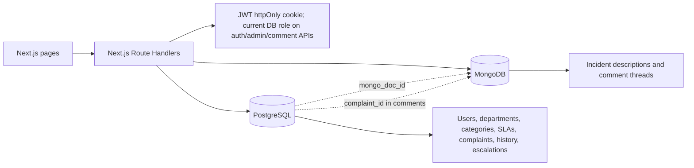
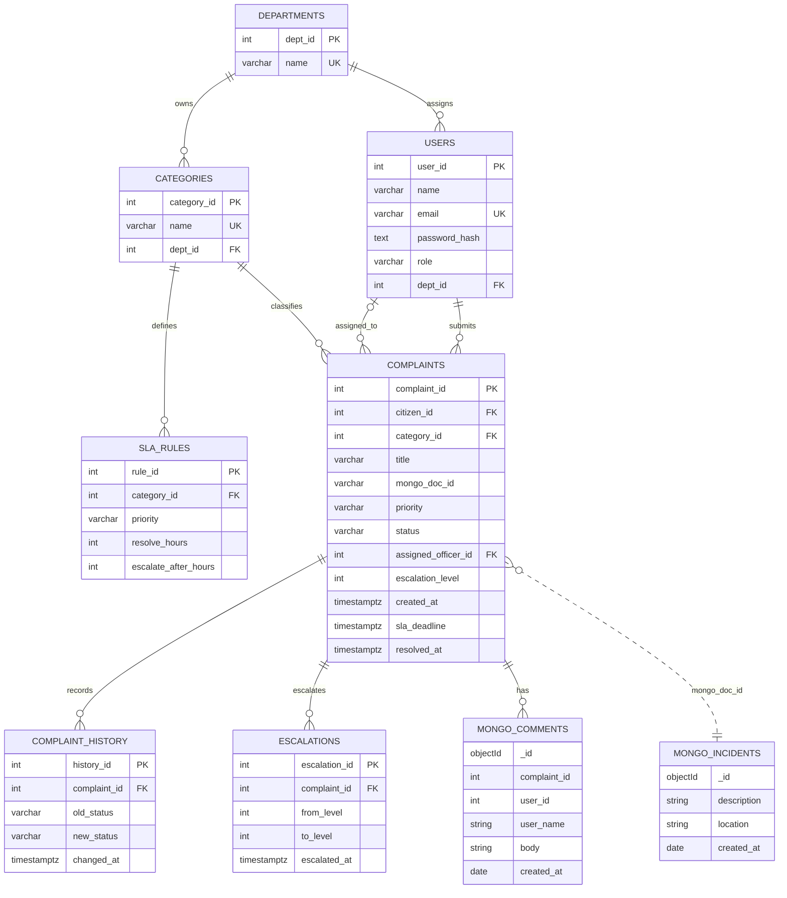

# Civic Complaint & Incident Tracking System

## Objectives and functional requirements

The application lets citizens report and track civic issues, routes those reports to department officers, and helps administrators monitor service-level deadlines and escalations.

- Citizens register, sign in, submit complaints with a category, priority, description, and optional location, and view their own complaint history.
- Officers see complaints in their department, claim open work, update status, and comment on accessible complaints.
- Administrators manage users, departments, categories, and SLA rules; review department performance and overdue work; and run escalation processing.
- The backend enforces role and record-level access. PostgreSQL constraints remain the final integrity boundary.

## Architecture



PostgreSQL stores the data whose relationships and integrity are essential: accounts, organizational ownership, complaint workflow, SLA rules, and status/escalation history. Foreign keys, checks, transactions, triggers, and relational queries make it the right source of truth for those records.

MongoDB stores flexible text-heavy incident details and comment threads. These documents can evolve independently of the relational workflow and are linked to PostgreSQL complaints by `mongo_doc_id` or `complaint_id`. The comment-summary endpoint uses a MongoDB aggregation pipeline.

## Entity relationship diagram



MongoDB references are logical links, not PostgreSQL foreign keys.

## Relational data dictionary

The authoritative DDL is [`../schema.sql`](../schema.sql).

| Table | Columns and constraints |
|---|---|
| `departments` | `dept_id SERIAL PRIMARY KEY`; `name VARCHAR(100) NOT NULL UNIQUE` |
| `users` | `user_id SERIAL PRIMARY KEY`; `name VARCHAR(100) NOT NULL`; `email VARCHAR(150) NOT NULL UNIQUE` with email-format check; `password_hash TEXT NOT NULL`; `role VARCHAR(10)` restricted to citizen/officer/admin; nullable `dept_id` references departments with `ON DELETE SET NULL`; officers must have a department |
| `categories` | `category_id SERIAL PRIMARY KEY`; globally unique `name VARCHAR(100) NOT NULL`; required `dept_id` references departments |
| `sla_rules` | `rule_id SERIAL PRIMARY KEY`; required category FK with `ON DELETE CASCADE`; `priority` restricted to low/medium/high/critical; positive `resolve_hours` and `escalate_after_hours`; unique `(category_id, priority)`; escalation duration cannot exceed resolution duration |
| `complaints` | `complaint_id SERIAL PRIMARY KEY`; required citizen/category FKs; `title VARCHAR(200)` with minimum trimmed length 5; optional `mongo_doc_id VARCHAR(24)`; priority/status checks; optional assigned officer FK; escalation level 0-3; creation/SLA/resolution timestamps; generated English `title_tsv`; resolved/closed complaints require `resolved_at` |
| `complaint_history` | `history_id SERIAL PRIMARY KEY`; required complaint FK with cascade delete; old/new status and timestamp |
| `escalations` | `escalation_id SERIAL PRIMARY KEY`; required complaint FK with cascade delete; from/to level and timestamp; `to_level = from_level + 1` |

## Important database features and queries

1. **Constraints and referential integrity:** primary/foreign keys, unique email/name/rule constraints, role/status/priority checks, officer-department requirement, positive SLA durations, and valid escalation increments.
2. **Generated column and full-text index:** `complaints.title_tsv` is generated from the title and indexed by GIN. Example search:

   ```sql
   SELECT complaint_id, title
   FROM complaints
   WHERE title_tsv @@ plainto_tsquery('english', 'street light');
   ```
3. **Triggers:** `trg_set_sla` calculates `sla_deadline` on complaint insert from the category/priority rule (72-hour fallback); `trg_stamp_resolved` sets `resolved_at`; `trg_log_status` records status changes.
4. **Stored procedure:** `sp_assign_complaint(complaint_id, officer_id)` locks the complaint, verifies the officer belongs to its category department, and assigns only open work.
5. **Set-based escalation function:** `fn_escalate_overdue()` locks eligible unresolved complaints, increments levels up to 3, writes escalation rows, and returns the count changed.
6. **Views and aggregate reporting:** `v_overdue_complaints` joins complaint/category/department/officer details; `v_dept_performance` groups complaint totals and on-time resolutions by department.

Representative DML and relational queries:

```sql
-- JOIN + filter + ORDER BY: a department's active queue
SELECT c.complaint_id, c.title, c.priority, c.status, u.name AS citizen
FROM complaints c
JOIN categories cat ON cat.category_id = c.category_id
JOIN users u ON u.user_id = c.citizen_id
WHERE cat.dept_id = $1 AND c.status NOT IN ('resolved', 'closed')
ORDER BY c.created_at DESC;

-- GROUP BY + aggregate + HAVING: categories with at least five reports
SELECT cat.name, COUNT(*) AS complaint_count
FROM complaints c
JOIN categories cat ON cat.category_id = c.category_id
GROUP BY cat.category_id, cat.name
HAVING COUNT(*) >= 5
ORDER BY complaint_count DESC;

-- INSERT / UPDATE / DELETE examples (IDs and values are parameters)
INSERT INTO departments (name) VALUES ($1) RETURNING dept_id;
UPDATE sla_rules SET resolve_hours = $1 WHERE rule_id = $2;
DELETE FROM categories WHERE category_id = $1;

-- Subquery: officers in departments with unresolved complaints
SELECT u.user_id, u.name
FROM users u
WHERE u.role = 'officer'
  AND EXISTS (
    SELECT 1
    FROM complaints c
    JOIN categories cat ON cat.category_id = c.category_id
    WHERE cat.dept_id = u.dept_id
      AND c.status NOT IN ('resolved', 'closed')
  );
```

All application SQL data values are parameterized. Dynamic update identifiers are selected only from a fixed allow-list in the account update route.

## MongoDB aggregation

The comment summary pipeline matches one complaint, groups by `user_id`, counts comments, selects the latest author name/time, and sorts latest contributors first:

```javascript
[
  { $match: { complaint_id: complaintId } },
  {
    $group: {
      _id: "$user_id",
      user_name: { $first: "$user_name" },
      comment_count: { $sum: 1 },
      latest_comment_at: { $max: "$created_at" }
    }
  },
  { $sort: { latest_comment_at: -1 } }
]
```

## Test results

Run the production build and the disposable-database API integration suite:

```sh
npm run build
TEST_DATABASE_URL=postgresql://localhost:5432/postgres \
MONGODB_URI=mongodb://localhost:27017/civic_db \
npm run test:integration
```

`TEST_DATABASE_URL` must be a local PostgreSQL connection with permission to create and drop a database. The test runner creates a unique disposable database, loads `schema.sql`, starts a temporary Next.js development server, runs API and database-trigger checks, removes its MongoDB test documents, and drops the temporary database. The application currently fixes the MongoDB database name as `civic_db`; the runner reserves and checks a process-specific high complaint-ID range before writing, then deletes only test comments and incidents. Use a disposable MongoDB test instance when running against non-local data.

The suite covers registration/login/logout, current-role revocation, admin-only writes, departments/categories/SLA CRUD paths, complaint submission and department assignment, status/history/SLA triggers, department reports, comments and access rules, MongoDB aggregation, and escalation processing.

| Check | Result |
|---|---|
| `npm run build` | Passed on the review branch |
| `npm run test:integration` | Passed against local PostgreSQL and MongoDB with a reserved test ID range |
| `npm run lint` | Passed with the committed Next.js ESLint configuration |

## Demo walkthrough

1. Start PostgreSQL and MongoDB; apply `schema.sql` and create the initial admin using the README instructions.
2. Register a citizen, sign in, and submit a complaint with a department category and description.
3. Sign in as an officer created by the admin, claim a complaint in that officer's department, update status, and add a comment.
4. Sign in as admin, create/rename departments and categories, configure SLAs, manage accounts, and review department performance and overdue complaints.
5. Age an open complaint past the configured escalation threshold in a demo database and trigger escalation from the admin-facing API.
